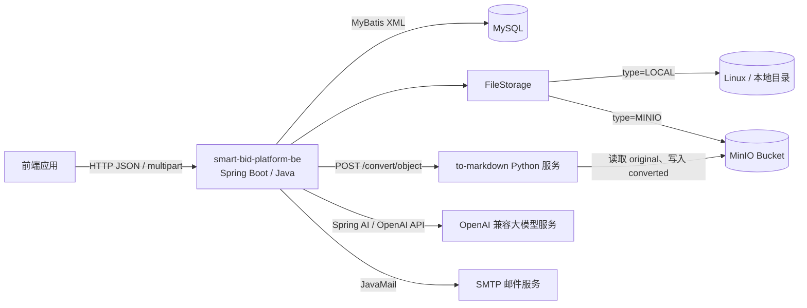
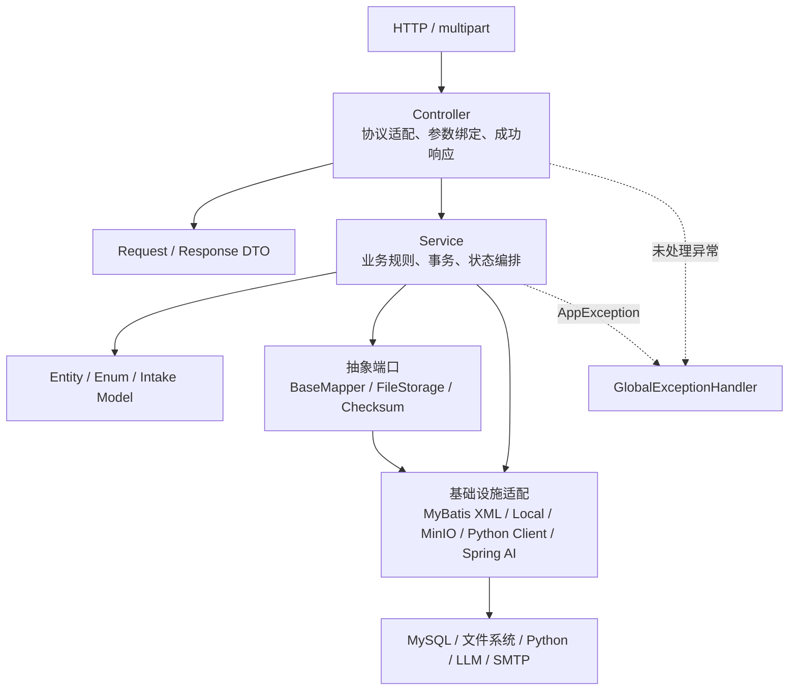
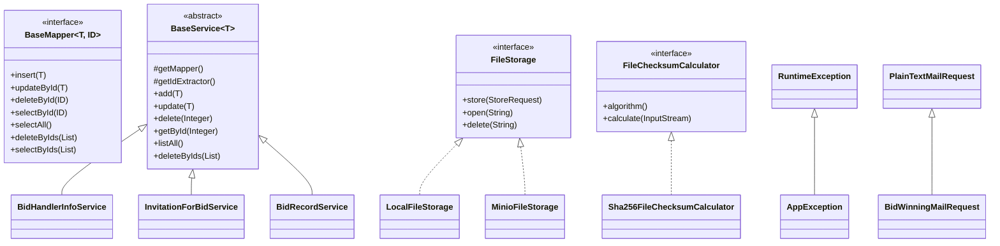
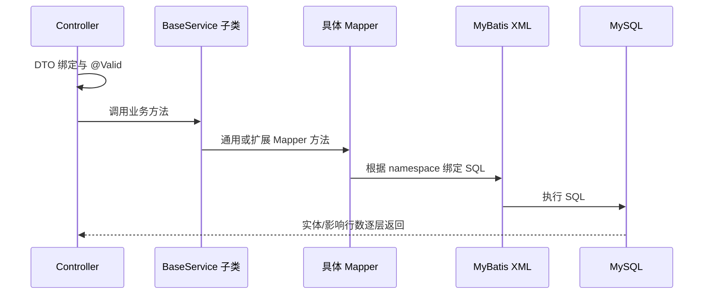
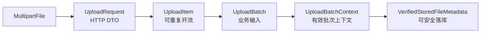
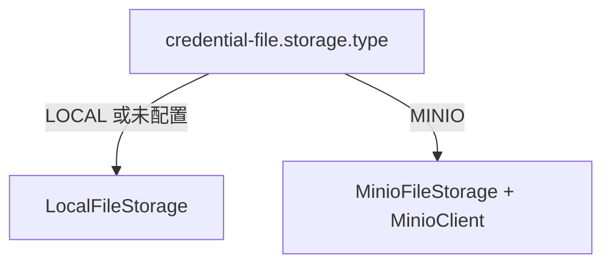
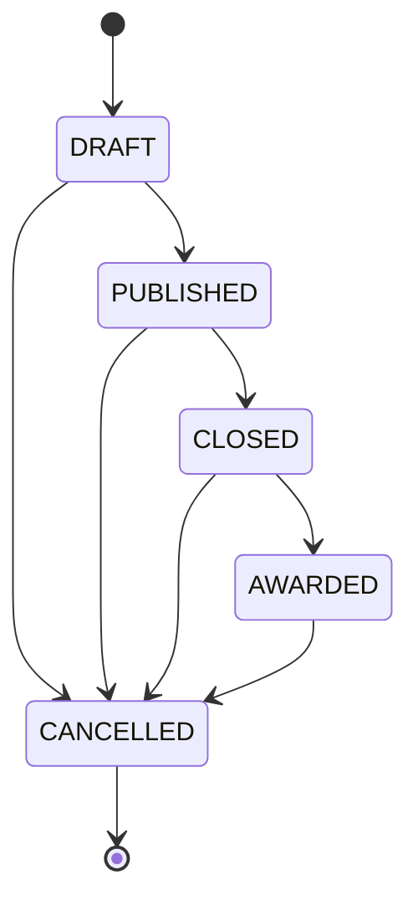
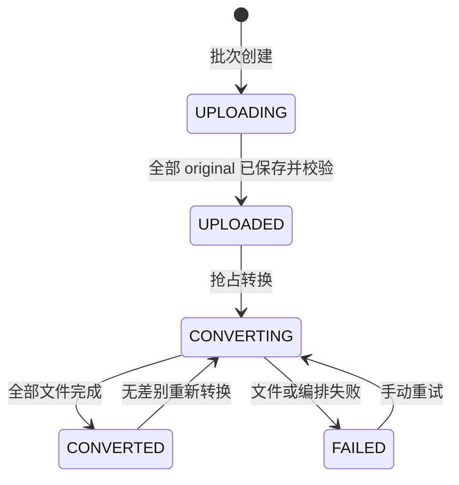
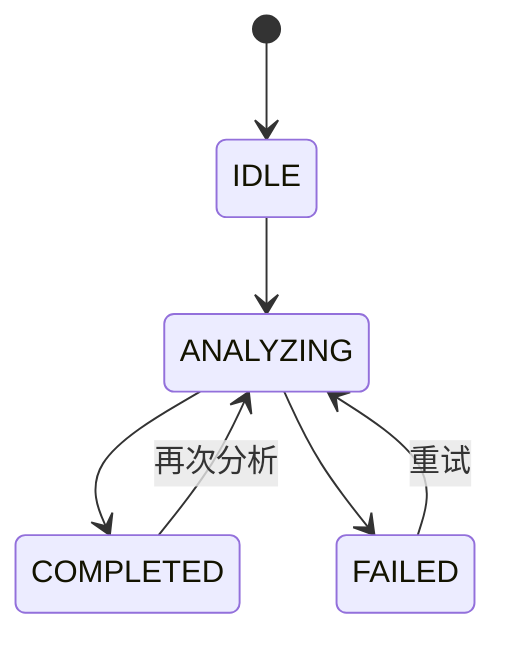
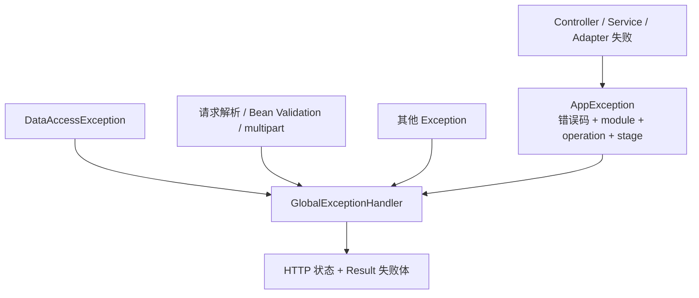

# smart-bid-platform-be 架构文档

> 本文档以 2026-07-28 当前工作区源码为准，描述 Java 后端的实际组织方式、模块职责、抽象关系、外部依赖和关键运行边界。
>
> 业务端点与逐步流程见 [business-process.md](business-process.md)，数据库关系与字段字典见 [database.md](database.md)。

## 1. 架构结论

当前项目是一个 Spring Boot 单体应用，采用“通用 CRUD 横向分层 + 资信文件垂直业务模块”的混合组织方式：

- 经办人、招标公告、投标记录使用 `Controller → Service → Mapper/XML → MySQL` 的通用 CRUD 分层。
- 资信文件模块按业务能力内聚了上传接入、校验和、存储、Python 转换、状态编排与 Markdown 汇总。
- 风险分析模块以 `bid_record` 为聚合入口，检查并按需完成文件转换后，读取 converted 文件生成投标记录级汇总 Markdown，再同步调用 OpenAI 兼容模型并落库。
- 文件正文不写入 MySQL。MySQL 保存文件元数据、状态和对象路径；正文由本地文件系统或 MinIO 保存。
- 数据库关系全部是逻辑外键，没有数据库级 `FOREIGN KEY`、级联删除或父记录存在性保障。
- 统一异常出口已经采用 `AppException + AppErrorCode + GlobalExceptionHandler + Result`；但异步任务失败和转换批次内部的单文件失败存在独立处理边界。

## 2. 系统上下文



### 2.1 边界说明

- 本仓库只实现 Java 服务。
- 前端、Python 转换服务、MySQL、MinIO/本地文件系统、大模型服务和 SMTP 都是外部运行依赖。
- Java 与 Python 之间传递的是对象路径，不是 Markdown 正文。Python 必须能够访问与 Java 一致的对象命名空间；生产形态应使用双方都可访问的 MinIO。
- `LOCAL` 存储适合单机联调。若 Python 与 Java 不共享同一文件系统，单纯配置本地目录无法完成转换。

## 3. 技术栈

| 范畴 | 当前实现 | 作用 |
|---|---|---|
| 运行时 | Java 25 | 应用运行与编译目标 |
| Web | Spring Boot 4.0.6、Spring WebMVC | REST、multipart、参数绑定 |
| 校验 | Jakarta Validation | `@Valid`、`@NotBlank`、`@Size` 等 |
| 数据访问 | MyBatis-Plus 3.5.15 + MyBatis XML | 实体映射与 SQL |
| 分页 | PageHelper 4.1.0 | ThreadLocal 分页 |
| 数据库 | MySQL | 业务记录、状态和文件元数据 |
| JSON | Fastjson2、`Fastjson2TypeHandler` | `bid_record.credentials` JSON 数组、模型响应解析 |
| 文件存储 | Java NIO / MinIO SDK 9.0.3 | 原始文件、转换文件和汇总 Markdown |
| 大模型 | Spring AI 2.0.0 OpenAI Starter | Structured Output 风险分析 |
| 邮件 | Spring Mail + Thymeleaf | 纯文本邮件和 HTML 通知 |
| 配置 | `@ConfigurationPropertiesScan` | 类型化绑定存储、转换和风险分析配置 |

## 4. 源码组织

```text
src/main/java/io/gitee/lujianshi/bidwinningbackend
├── BidWinningBackendApplication.java       启动、配置扫描、Mapper 扫描
├── config/                                 跨模块配置模型
├── controller/                             通用业务 Controller 与全局异常出口
├── credentialfile/                         资信文件垂直业务模块
│   ├── checksum/                           校验和算法抽象与 SHA-256 实现
│   ├── client/                             Python HTTP 客户端及协议 DTO
│   ├── config/                             存储、转换服务配置
│   ├── controller/                         上传、转换入口
│   ├── dto/                                HTTP 响应/请求 DTO
│   ├── entity/                             文件与批次实体
│   ├── enums/                              文件状态、存储类型、汇总状态
│   ├── intake/                             multipart 到业务输入的内部模型
│   ├── mapper/                             文件与批次 Mapper
│   ├── processor/                          单文件上传处理器
│   ├── service/                            上传、转换、Markdown 汇总编排
│   └── storage/                            存储抽象及 Local/MinIO 适配器
├── dto/                                    经办人、公告、投标、邮件和公共 DTO
├── entity/                                 核心关系型实体
├── enums/                                  招标公告状态
├── exception/                              结构化错误码与应用异常
├── mapper/                                 通用 Mapper 抽象与核心 Mapper
├── service/                                通用 CRUD 与核心业务服务
│   ├── mail/
│   ├── riskanalysis/
│   └── statuscheck/
└── utils/                                  Prompt、模板搜索、异步线程工具

src/main/resources
├── application.yml                         应用、multipart、文件、转换、风险配置
├── application-dev.yml                     MySQL、模型、邮件、日志配置
├── mapper/                                 MyBatis XML
├── prompts/                                风险分析 Prompt
├── sql/ddl/                                V1-V24 手工迁移脚本
└── templates/                              Thymeleaf 邮件模板
```

## 5. 分层与依赖方向



依赖原则是上层依赖能力接口或业务服务，基础设施不反向调用 Controller。例外和当前限制如下：

- `ToMarkdownClient` 是业务模块内的基础设施客户端，直接被 `FileConvertService` 使用。
- `RiskAnalysisService` 直接依赖 Spring AI 的 `ChatClient`，目前没有再抽象模型网关接口。
- `BaseService` 同时承载 CRUD 和邮件辅助能力，职责并不完全单一。
- `AsyncTaskManager` 使用原生 `new Thread()`，没有使用 Spring 线程池。

## 6. 模块分工

| 模块 | 主要类 | 输入 | 输出/副作用 | 不负责 |
|---|---|---|---|---|
| 招标经办人 | `BidHandlerInfoController/Service/Mapper` | 经办人 CRUD 请求 | `bid_handler_info`、可选异步邮件 | 公告关联完整性 |
| 招标公告 | `InvitationForBidController/Service` | 公告 CRUD、状态变更 | `invitation_for_bid`、状态历史 | 校验经办人是否存在 |
| 投标记录 | `BidRecordController/Service` | 投标 CRUD | 自动生成 `bid_no`，写 `bid_record` | 上传/转换正文 |
| 资信上传 | `FileUploadService`、`UploadItemProcessor` | `UploadBatch` | original 文件、批次和文件元数据 | Markdown 转换 |
| 资信转换 | `FileConvertService`、`ToMarkdownClient` | `bidRecordId` | Python 转换、文件/批次状态、`credentials` 路径 | 风险分析 |
| Markdown 汇总 | `CredentialMarkdownAggregationService` | `bidRecordId` | 固定路径 `merged/credentials.md` | 调用大模型 |
| 风险分析 | `RiskAnalysisService` | `bidRecordId` | 检查/按需转换、汇总、LLM 调用、`risk_analysis` | 文件上传和文件状态持久化 |
| 文件存储 | `FileStorage` 及实现 | 路径、流、metadata | 保存、读取、删除对象 | 业务状态与数据库 |
| 异常出口 | `GlobalExceptionHandler` | 未解决异常 | HTTP 状态 + `Result` | 业务补偿与状态修复 |
| 邮件 | `MailService`、`StatusCheckService` | 邮件 DTO | SMTP 发送 | 保证异步投递成功 |

## 7. 继承、接口与抽象

### 7.1 类型关系



### 7.2 抽象明细

| 抽象 | 实现/子类 | 复用目的 | 当前边界 |
|---|---|---|---|
| `BaseMapper<T, ID>` | 5 个核心 Mapper 及 2 个文件 Mapper | 统一 7 个基础 SQL 方法签名 | SQL 仍由每个 XML 重复定义 |
| `BaseService<T>` | 经办人、公告、投标记录 Service | 统一基础 CRUD、批量删除、事务和邮件辅助 | 主键类型固定为 `Integer`，不适合 `Long/String` 文件主键 |
| `FileStorage` | `LocalFileStorage`、`MinioFileStorage` | 上层不感知物理介质 | Python 转换实际上更适合共享 MinIO |
| `FileChecksumCalculator` | `Sha256FileChecksumCalculator` | 算法与文件来源解耦 | 当前只注册 SHA-256 |
| `AppException` | 当前直接实例化，暂未增加业务子类 | 承载稳定错误码和业务上下文 | 补偿仍由业务 Service 完成 |
| `PlainTextMailRequest` | `BidWinningMailRequest` | 复用收件人、主题、正文等字段 | DTO 继承不影响数据库 |

核心实体之间没有 Java 继承；数据库表之间也没有“表继承”。业务上的上下级关系通过逻辑外键表达，详见 [database.md](database.md)。

## 8. 通用 CRUD 架构



### 8.1 `BaseService` 提供的行为

- 写方法 `add/update/delete/deleteByIds` 使用 `@Transactional(rollbackFor = Exception.class)`。
- PATCH 通过 Mapper XML 中的动态 `<set>` 实现：值为 `null` 的字段不更新，因此当前接口不能把已有字段显式置为 SQL `NULL`。
- 批量删除先查询存在记录，再只删除实际存在的 ID，并把这些实体返回给前端。
- 经办人新增完成后，Controller 显式触发异步邮件；邮件不属于数据库事务。

### 8.2 业务扩展

- `InvitationForBidService` 重写 `add`，补充 `createdAt` 与初始状态 `DRAFT`。
- `InvitationForBidService.transitionStatus` 使用“状态机校验 + 条件更新 + 历史插入”的事务。
- `BidRecordService` 重写 `add`，按 `(invitationId, bidderName)` 计算 `max(bid_no)+1`；唯一索引冲突时最多重试 3 次。

## 9. 资信文件架构

### 9.1 内部模型转换



- `UploadRequest` 只承载 HTTP multipart。
- `UploadItem` 把 `MultipartFile#getInputStream` 包装为可重复打开的流入口，支持上传前计算 SHA-256 和实际存储时再次读取。
- `VerifiedStoredFileMetadata` 只在存储完成且回读校验通过后产生，是写入 `credential_file` 的安全边界。

### 9.2 存储路径

```text
bid-records/{bidRecordId}/
├── batches/{uploadBatchId}/
│   ├── original/{uuid}_{safeOriginalFilename}
│   └── converted/{converter-defined-name}.md
└── merged/credentials.md
```

- original 路径由 Java 的 `StoragePath` 生成。
- converted 路径由 Python 转换服务生成，Java 校验响应后写入 `credential_file.markdown_file_path`。
- merged 路径由 Java 固定为 `bid-records/{bidRecordId}/merged/credentials.md`，每次风险分析前覆盖。
- `bid_record.credentials` 是已转换文件路径的 JSON 投影，不存正文，也不是风险分析的唯一事实来源。

### 9.3 存储适配选择



两个实现都遵循以下契约：

- `store` 的目标路径已存在时覆盖；
- `open` 返回由调用方关闭的输入流；
- `delete` 用于失败补偿；
- 上层只保存逻辑相对路径或 object key，不保存绝对路径。

## 10. 状态模型

### 10.1 招标公告



状态变更通过当前状态条件更新实现乐观并发控制，并在同一事务写入历史表。

### 10.2 资信文件和批次



文件通常从 `UPLOADED` 开始；批次会经历 `UPLOADING`。转换接口不按旧状态过滤业务意图，但 Mapper 通过条件更新保证同一记录只有一个请求能获得处理权。

### 10.3 风险分析



`bid_record.risk_analysis_status` 是当前任务状态；历史结果保存在 `risk_analysis`，因此一个投标记录可以有多次成功分析。

## 11. 事务、并发与补偿

| 场景 | 一致性机制 | 事务/补偿边界 |
|---|---|---|
| 通用 CRUD 写入 | Spring 事务 | 只覆盖数据库 |
| 公告状态变更 | `WHERE status = fromStatus` 条件更新 | 状态更新和历史插入同一事务 |
| 投标序号生成 | 唯一索引 `uk_attempt` + 最多 3 次重试 | 单次新增事务 |
| 文件批次号生成 | 唯一索引 `uk_bid_record_batch_no` + 最多 3 次重试 | 上传数据库事务 |
| 文件上传 | DB 事务 + 存储对象逆序删除 | 数据库可回滚；对象删除是尽力补偿 |
| 文件转换 | 批次/文件条件更新抢占 | Python 调用不在 DB 事务内；失败转 `FAILED` |
| `credentials` 回写 | `SELECT ... FOR UPDATE` 锁定 `bid_record` | 只包含数据库查询与更新 |
| 风险分析抢占 | `IDLE/COMPLETED/FAILED → ANALYZING` 条件更新 | 模型调用在事务外 |
| 风险结果落库 | 插入结果 + 标记 `COMPLETED` | 同一数据库事务 |

当前仍需注意：

- Java 进程在获得风险分析权后直接退出，记录可能停留在 `ANALYZING`，目前没有超时恢复任务。
- 风险分析和手动重新转换之间没有互斥锁；调用方应避免同时操作同一 `bidRecordId`。
- 文件存储与 MySQL 不是分布式事务。补偿删除失败会作为 suppressed exception 保留，但无法保证物理对象一定清除。

## 12. 异常架构



失败响应的当前字段为：

```json
{
  "success": false,
  "code": "CREDENTIAL_FILE.CONVERSION_FAILED",
  "message": "资信文件转换服务调用失败",
  "service": "bid-winning-backend",
  "module": "credential-file",
  "operation": "CONVERT",
  "stage": "PYTHON_CALL",
  "retryable": true,
  "errorId": "随机 UUID"
}
```

边界说明：

- `traceId` 字段已定义，但当前没有过滤器生成或透传，因此通常不会出现在响应中。
- `errorId` 由全局处理器生成，但当前没有统一写入日志上下文。
- AppException 的底层 cause 不向前端暴露。
- Python 单文件转换失败通常被 `FileConvertService` 收敛为文件/批次 `FAILED`，转换端点仍以 HTTP 200 返回汇总结果。
- 异步邮件在线程中失败时只打印日志，HTTP 已经成功返回，不会进入 `GlobalExceptionHandler`。
- `StatusCheckController` 三个成功响应是纯字符串；它们发生同步异常时仍会被全局处理器转换为 JSON 错误体。

完整错误流向见 [business-process.md](business-process.md)。

## 13. 配置传导

启动类使用 `@ConfigurationPropertiesScan`，因此配置类无需单独注册：

| YAML 前缀 | 配置类 | 消费者 |
|---|---|---|
| `credential-file.converter` | `FileConverterProperties` | `ToMarkdownClient` |
| `credential-file.storage` | `FileStorageProperties` | Local/MinIO 存储及 MinIO 配置 |
| `risk-analysis` | `RiskAnalysisProperties` | Markdown 汇总长度校验 |
| `spring.datasource` | Spring Boot 自动配置 | MyBatis/MySQL |
| `spring.ai.openai` | Spring AI 自动配置 | `OpenAiChatModel` |
| `spring.mail` | Spring Mail 自动配置 | `JavaMailSender` |

当前配置分布：

- `application.yml`：服务端口、multipart 限制、默认 profile、转换地址、存储配置、128K 字符限制。
- `application-dev.yml`：MySQL、OpenAI 兼容模型、邮件和日志。
- 敏感配置通过环境变量读取；MinIO 凭证为空时，只有切换到 `MINIO` 才会在 Bean 创建阶段校验失败。

## 14. 当前架构边界与维护注意事项

| 项目 | 当前事实 | 影响 |
|---|---|---|
| 鉴权 | Controller 未接入认证授权 | 所有端点默认可访问 |
| 数据库外键 | 只有逻辑关系 | 可产生孤儿数据，删除不会级联 |
| 上传父记录校验 | 上传服务不查询 `bid_record` 是否存在 | 可写入不存在 `bidRecordId` 的元数据和对象路径 |
| 文件删除 | 删除端点是占位实现 | 返回成功但不删除对象和数据库行 |
| 转换触发 | 上传请求不会自动转换；风险分析入口会按需调用无差别转换流程 | 可手动调用转换端点，也可由风险分析入口自动触发 |
| 风险分析前置 | 先检查批次和文件；必要时自动转换并重新查询状态 | 只有全部批次和文件最终为 `CONVERTED` 才会继续汇总和调用大模型 |
| 转换无批次 | 返回 `ALL_CONVERTED` 成功 | “没有材料”与“全部完成”在转换接口语义上相同 |
| 汇总覆盖 | 固定 merged object key | 重复分析不会累加文件，但会覆盖上次汇总 |
| Prompt 加载 | 读取失败返回空字符串 | 不会立即报模板缺失，可能导致模型输入质量下降 |
| 异步执行 | 每个任务新建原生线程 | 无线程池、无任务持久化、无统一异常出口 |
| DDL 执行 | 只有 Flyway 风格文件名，未启用 Flyway | 部署时需要外部迁移流程 |

## 15. 文档导航

- [业务流程与异常处理](business-process.md)
- [数据库关系与字段字典](database.md)
- [HTTP 请求字段参考](api.md)
- [Structured Output 说明](structured-output.md)
