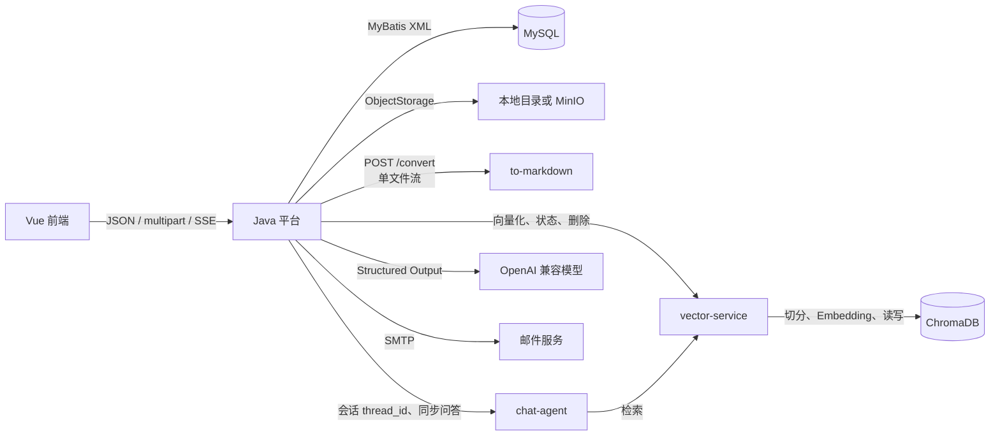

# smart-bid-platform-be 架构文档

> 本文以当前 `src/main/java`、`src/main/resources/mapper` 和 `sql/ddl/V1-V54` 为准，最后复核于 2026-08-09。HTTP 字段以 Controller/DTO 为准，数据库以实际已执行迁移和 Mapper SQL 为准。

## 1. 系统边界

该仓库是 Spring Boot 单体后端。Java 负责 HTTP 协议、账号校验、MySQL 元数据、对象存储编排、状态机和跨服务调用；文件正文与向量不保存在 Java 进程内。



- `to-markdown` 只接收文件流并返回 Markdown，不读取 MySQL、MinIO 或业务对象 key。
- `vector-service` 独立负责 Markdown 切分、Embedding、ChromaDB 持久化、状态查询、删除与检索；Java 负责决定何时写入、替换或删除。
- `chat-agent` 只处理问答编排并通过 HTTP 调用 `vector-service` 检索；Java 保存业务会话和消息历史，并在调用时传递稳定的 `thread_id`。
- MySQL 是文件生命周期、列表状态与下载前置条件的事实源；SSE 仅通知前端重新读取，不承载状态真值。

## 2. 分层与依赖方向

```text
Controller / Interceptor
  → 角色 ApplicationService、业务 Service
    → Mapper/XML、ObjectStorage、VectorStorage、HTTP Client、Spring AI
      → MySQL、MinIO/Local、to-markdown、vector-service、chat-agent、模型、SMTP
```

通用 CRUD 使用 `Controller → Service → Mapper/XML`。文件 HTTP 入口按角色组织，`BidderFileApplicationService` 与 `BidInviterFileApplicationService` 负责鉴权后的业务编排；资信和知识文件仍保留各自状态机。业务服务依赖 `storage.object` 与 `storage.vector`，基础设施不反向调用 Controller。

关键模块：

| 模块 | 主要职责 |
|---|---|
| `controller.bid_inviter` | 招标方 Basic 鉴权后的公告、经办人、投标记录、知识文件、下载、风险分析和问答入口 |
| `controller.bidder` | 投标方本人投标记录、资信文件上传/列表/删除/下载/SSE；每次操作同时做 Basic 与记录归属校验 |
| `service.file` | 投标方/招标方文件入口的角色鉴权、归属校验与业务编排 |
| `service.bidrecord` | `BidRecordService`、生命周期编排与投标记录向量索引刷新 |
| `credentialfile` | 单文件上传、SHA-256 双读校验、转换和资信 Markdown 汇总 |
| `knowledgefile` | 知识文件 original、转换、向量化、重试、删除与生命周期追溯 |
| `storage.object` | `ObjectStorage` 及 Local/MinIO 实现；资信与知识 Bean 保持独立配置和 bucket |
| `storage.vector` | Java 到 vector-service 的知识、资信、投标记录三类协议适配与一致性校验 |
| `chatagent` | Java 侧会话、消息、顺序号、幂等请求与 Python 调用协调 |
| `realtime` | `FileStatusEventPublisher` 的 topic 订阅、状态事件和心跳 |
| `service.riskanalysis` | 文件完成校验、Markdown 汇总、模型调用与风险结果落库 |

## 3. 鉴权与资源归属

系统当前是演示级 HTTP Basic 鉴权，没有租户隔离或 RBAC。

```text
投标方文件请求
  Authorization → BidderAccountService.authenticateBasic
    → BidderFileApplicationService.requireOwned
      → bid_record.bidder_account_id == 当前 bidderAccountId
        → 文件必须属于 URL 指定的 bidRecordId

招标方管理/下载请求
  Authorization → BidInviterAuthInterceptor
    → CurrentAccountContext(BID_INVITER)
      → 可访问未删除且满足下载就绪条件的所有投标资信材料
```

`credential_file` 不直接保存账号 ID；其归属链是 `credential_file.bid_record_id → bid_record.bidder_account_id`。招标方下载调用 `FileDownloadService` 时不传投标记录归属限制，这是有意的角色边界，不等同于投标方越权。

## 4. 文件生命周期

### 4.1 资信材料

`POST /bidder/bid-records/{id}/credential-files` 使用重复 `files` 字段批量提交，但每个文件都是独立文件单元，不存在上传批次表或 `uploadBatchId`。

```text
文件选择
  → authenticateBasic + requireOwned
  → INSERT credential_file(STORING, UPLOADED)
  → ObjectStorage.store(original) + 回读 SHA-256
  → 回填 original path / original sha / STORED + CREATE 历史
  → 发布 SSE 状态事件
  → FileConvertService.convertFileAsync(fileId)
      → 后台读取 original → POST to-markdown /convert
      → 保存并回读 Markdown → CONVERTED 或 FAILED
      → 更新 credentials JSON 投影、历史、SSE
```

转换由 `fileProcessingExecutor` 后台执行；上传响应是提交瞬间的数据库快照，可能仍为 `UPLOADED`。招标方手动转换入口和风险分析中的补偿转换会调用同步的 `FileConvertService.convertAll`，但它们同样以文件为最小抢占单位。

状态分别表达不同事实：

```text
原始对象：STORING → STORED / FAILED
转换状态：UPLOADED → CONVERTING → CONVERTED / FAILED
```

`original_storage_status` 供列表/SSE 显示和生命周期追溯；下载服务最终以数据库中的路径与 SHA-256 判断原文件是否就绪。Markdown 下载还要求 `convert_status=CONVERTED`、Markdown 路径和 `converted_sha256` 都已存在。

资信对象 key 由 `StoragePath` 统一生成：

```text
{username}/{safeFilename}/original/{fileUuid}_{safeFilename}
{username}/{safeFilename}/converted/{markdownFilename}
{username}/merged/{bidRecordId}/credentials.md
```

### 4.2 知识文件

知识文件由招标方鉴权上下文提交；`documentUuid` 同时是数据库主身份、对象目录根和 vector-service 向量身份。

```text
INSERT knowledge_file(STORING, UPLOADED, PENDING)
  → 原始对象存储与回读校验
  → 后台 processStoredFileAsync
      → to-markdown
      → CONVERTED
      → KnowledgeFileVectorStorage 调用 vector-service 向量化
      → VECTORIZED 或按失败点 FAILED
```

```text
转换：UPLOADED → CONVERTING → CONVERTED / FAILED
向量：PENDING → VECTORIZING → VECTORIZED / FAILED
```

重试依据当前持久化状态继续转换或向量化；删除按 `DELETING → DELETED` 状态机删除 Chroma、original、Markdown 并保留操作历史。失败会写入阶段和错误原因，后续删除/重试可以幂等续跑。

### 4.3 状态通知与下载

- 知识文件：`GET /knowledge-files/events`。
- 资信文件：`GET /bidder/bid-records/{id}/credential-files/events`。
- 事件名为 `file-status`，包含资源 ID、original/convert/index 状态与时间；前端收到事件后重新查询列表，避免把事件负载当作完整记录。
- 下载接口统一由 `FileDownloadService` 打开受保护的流：原文件保留原始名称，Markdown 始终以 `.md` 下载。前端用一个下载图标打开“原文件 / 下载 .md”的选择弹窗。

## 5. chat-agent 会话边界

`ChatAgentConversationService` 是 Java 与 Python 的业务边界：

1. Java 创建并保存 `ChatConversation`，以 `conversationId` 作为 Python `thread_id`。
2. 同一会话使用 JVM 内独立锁，短事务内分配消息顺序号。
3. `clientMessageId` 是幂等键；重试同一请求返回已有完成结果，冲突内容则拒绝。
4. Java 先保存用户消息，再同步调用 Python；成功后保存助手消息与标题，失败时把消息标为失败。

chat-agent 不再直接拥有切分、Embedding 或 ChromaDB。其检索工具通过 `VECTOR_SERVICE_BASE_URL` 调用 vector-service；因此向量写入链路与问答链路可以独立启动、测试和失败恢复。

因此 Python 不承担平台的用户归属、会话列表和消息审计。当前限制是单 Java 实例下的 JVM 锁；若未来多实例部署，需改变并发协调方式。

## 6. 风险分析

风险分析以 `bid_record` 为聚合入口：先条件更新抢占 `ANALYZING`，读取资信文件状态；如果未全部转换，调用 `FileConvertService.convertAll` 后重新查询。只有所有文件均为 `CONVERTED` 且 Markdown 路径存在时，才汇总 `{username}/merged/{bidRecordId}/credentials.md` 并调用模型。

模型调用在数据库事务外，成功时以事务写 `risk_analysis` 和 `COMPLETED`；失败尽力标记为 `FAILED`。当前没有 `ANALYZING` 的超时恢复，也没有风险分析与手动转换之间的记录级互斥锁。

## 7. 数据与运行约束

- 所有表关系是逻辑外键；删除父记录不会由数据库级联处理。
- `sql/ddl/V*.sql` 使用 Flyway 风格名称，但应用未启用 Flyway，执行历史必须由环境管理。当前最新版本为 V54；数据库必须按目标环境的实际执行历史顺序补齐。
- 文件存储与 MySQL 不构成分布式事务。上传、转换和删除通过状态列、回读校验和尽力补偿收敛，不能假设对象和数据库总是原子一致。
- `CurrentAccountContext` 是请求线程的 ThreadLocal，仅供审计/业务服务读取；异步任务不得依赖请求结束后仍存在该上下文。

## 8. 文档导航

- [HTTP 契约](api.md)
- [主业务链与失败边界](business-process.md)
- [数据库字段与 DDL](database.md)
- [前端架构](../../smart-bid-platform-fe/docs/架构说明.md)
