# smart-bid-platform-be 业务流程文档

> 本文档以 2026-07-28 当前工作区源码为准，覆盖 31 个显式 Controller 端点。Spring Actuator 自动生成的管理端点不计入业务端点。
>
> 系统分层见 [architecture.md](architecture.md)，表关系见 [database.md](database.md)。

## 1. 端点总览

| 模块 | 数量 | Controller |
|---|---:|---|
| 服务状态与邮件测试 | 3 | `StatusCheckController` |
| 招标经办人 | 7 | `BidHandlerInfoController` |
| 招标公告 | 8 | `InvitationForBidController` |
| 投标记录 | 7 | `BidRecordController` |
| 资信文件 | 3 | `FileUploadController`、`FileConvertController` |
| 风险分析 | 3 | `RiskAnalysisController` |
| 合计 | 31 | 7 个 Controller |

## 2. 通用 HTTP 与异常约定

### 2.1 成功响应

除 `StatusCheckController` 的 3 个端点外，成功响应统一使用：

```json
{
  "success": true,
  "code": "SUCCESS",
  "message": "查询成功",
  "data": {}
}
```

`Result` 使用 `NON_NULL` 序列化，未设置的 `service/module/operation/stage/traceId/errorId/details` 不出现在成功响应中。

### 2.2 失败响应

```json
{
  "success": false,
  "code": "RISK_ANALYSIS.INPUT_NOT_READY",
  "message": "资信材料尚未全部转换完成",
  "service": "bid-winning-backend",
  "module": "risk-analysis",
  "operation": "ANALYZE_RISK",
  "stage": "VALIDATE_INPUT",
  "retryable": false,
  "errorId": "d77c98d0-..."
}
```

- HTTP 状态由 `AppErrorCode.httpStatus` 决定，不再固定返回 200。
- `traceId` 字段虽然存在，但当前没有生成与透传逻辑。
- `errorId` 每次失败随机生成；当前尚未统一写入日志上下文。
- 底层堆栈、SQL、MinIO 地址和外部服务响应不会直接暴露给前端。

### 2.3 全局异常流向

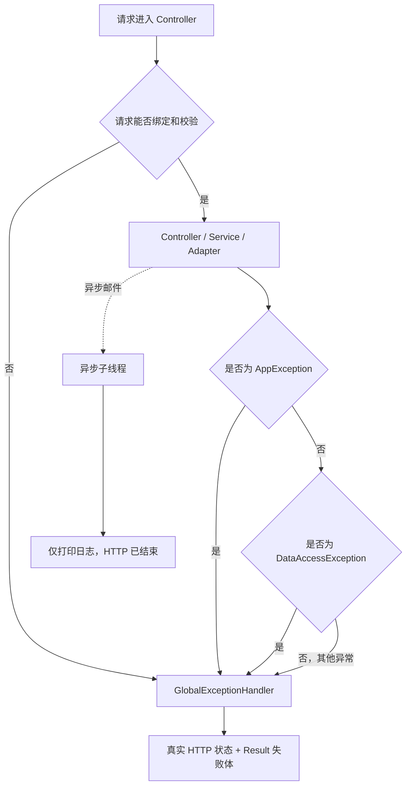

### 2.4 通用错误映射

| 失败来源 | 错误码 | HTTP | 说明 |
|---|---|---:|---|
| Bean Validation、参数类型、缺少参数/文件 | `COMMON.INVALID_ARGUMENT` | 400 | 返回首条校验消息 |
| JSON 无法解析、枚举值无效 | `COMMON.REQUEST_PARSE_FAILED` | 400 | 请求未进入业务 Service |
| multipart 超过 150MB 单文件或 200MB 请求限制 | `COMMON.FILE_TOO_LARGE` | 413 | Spring 在绑定阶段抛出 |
| 唯一键冲突且未被业务转换 | `DATABASE.DUPLICATE_KEY` | 409 | module 固定为 `database` |
| 数据完整性约束失败 | `DATABASE.CONSTRAINT_VIOLATION` | 409 | 例如 NOT NULL、JSON 约束 |
| 数据库连接失败 | `DATABASE.CONNECTION_FAILED` | 503 | 通用 DAO 出口 |
| 数据库超时 | `DATABASE.QUERY_TIMEOUT` | 504 | 通用 DAO 出口 |
| 其他数据库访问失败 | `DATABASE.OPERATION_FAILED` | 500 | 通用 DAO 出口 |
| `IllegalArgumentException` | `COMMON.INVALID_ARGUMENT` | 400 | 同步调用链内才会进入全局处理器 |
| 未分类异常 | `SYSTEM.INTERNAL_ERROR` | 500 | 不暴露原始异常消息 |

## 3. 可复用的基础流程

### 3.1 基础新增流程 F-CREATE

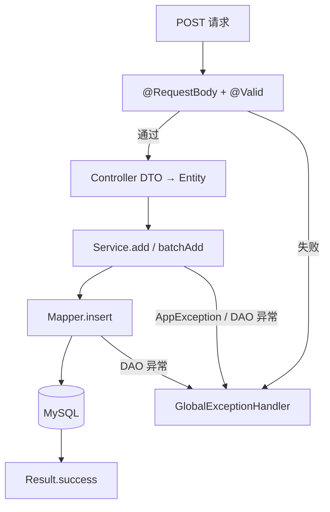

### 3.2 单记录查询、PATCH、删除流程 F-SINGLE

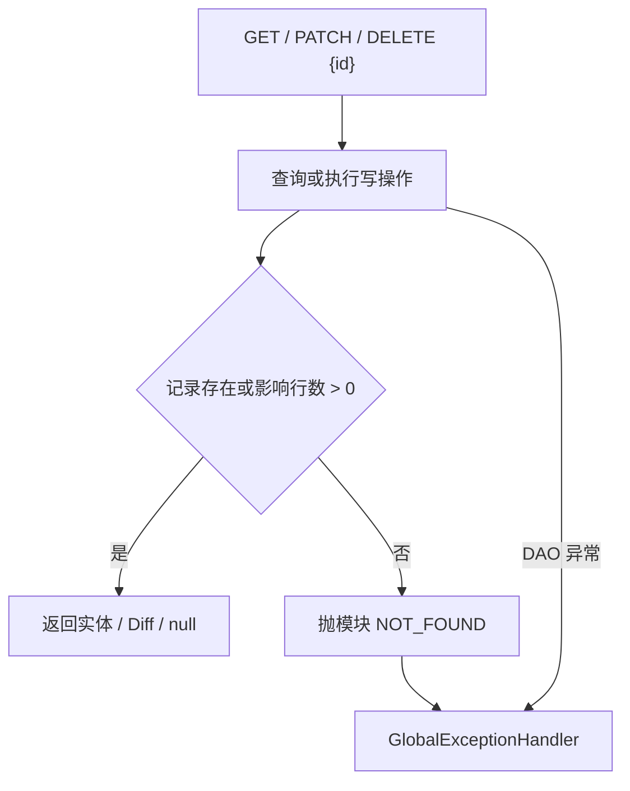

PATCH 只更新非 `null` 字段，当前不能用 PATCH 把已有列置为 SQL `NULL`。

### 3.3 分页与批量删除流程 F-LIST/BATCH-DELETE

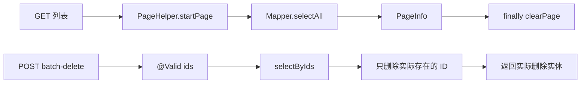

批量删除不存在的 ID 不报 404；它们不会出现在返回列表中。

## 4. 服务状态与邮件测试

### 4.1 端点逐项步骤

| 端点 | 具体步骤 | 成功结果 | 主要异常 |
|---|---|---|---|
| `GET /service-status` | 1. 进入 Controller；2. 直接返回固定字符串 | `Service is up and running.` | 仅未分类系统异常 |
| `POST /send-email` | 1. JSON 绑定到 `PlainTextMailRequest`；2. 读取配置发件人；3. 构造 `SimpleMailMessage`；4. 同步调用 SMTP；5. 返回字符串 | `Email sent successfully.` | JSON 解析错误；SMTP 运行时异常当前落入 `SYSTEM.INTERNAL_ERROR` |
| `POST /send-notification` | 1. 绑定 `BidWinningMailRequest`；2. 同步确认模板存在；3. Thymeleaf 渲染 HTML；4. 新建子线程并延迟 5 秒；5. 主线程立即返回；6. 子线程发送 SMTP | `发送成功` | 模板不存在/搜索失败为 `COMMON.INVALID_ARGUMENT`；异步发送失败只打印日志 |

这三个请求 DTO 当前没有 `@Valid`，空字段可能直到模板或邮件组件内部才失败。

### 4.2 HTML 通知时序

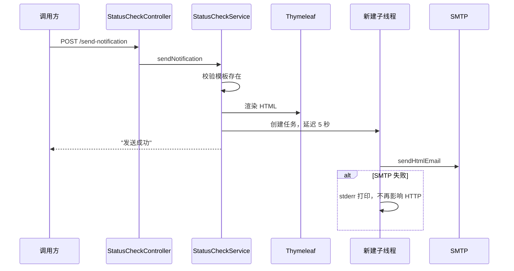

## 5. 招标经办人

### 5.1 端点逐项步骤

| 端点 | 使用流程 | 具体业务步骤 | 成功数据 | 业务异常 |
|---|---|---|---|---|
| `POST /bid-handler-info/add` | F-CREATE | 校验 4 个必填字段；构造实体；插入；获得自增 ID；提交后触发异步 CRUD 邮件 | `BidHandlerInfo` | DB 错误；异步邮件失败不影响成功响应 |
| `POST /bid-handler-info/batch-add` | F-CREATE | 校验 `items` 1-100；单事务逐条插入；提交后按外层 `targetEmail` 发送一封汇总邮件 | `List<BidHandlerInfo>` | 任一插入失败则整个批次回滚；异步邮件失败不回滚 |
| `GET /bid-handler-info/{id}` | F-SINGLE | 按主键查询；不存在抛模块异常 | 实体 | `BID_HANDLER.NOT_FOUND` 404 |
| `PATCH /bid-handler-info/{id}` | F-SINGLE | 先查 before；构造仅含非空字段的 patch；更新；返回 before/after | `Diff<BidHandlerInfo>` | `BID_HANDLER.NOT_FOUND` 404；DTO 校验 400 |
| `DELETE /bid-handler-info/{id}` | F-SINGLE | 物理删除；影响行数为 0 则不存在 | `null` | `BID_HANDLER.NOT_FOUND` 404 |
| `GET /bid-handler-info` | F-LIST | PageHelper 分页；默认 `bid_handler_id desc`；finally 清理 ThreadLocal | `PageInfo` | 参数/SQL 错误进入全局处理器 |
| `POST /bid-handler-info/batch-delete` | F-BATCH-DELETE | 校验 `ids` 1-500；查询存在项；单事务物理删除；返回存在项 | 实际删除实体列表 | DB 错误；不存在的 ID 不报错 |

### 5.2 新增和异步邮件边界

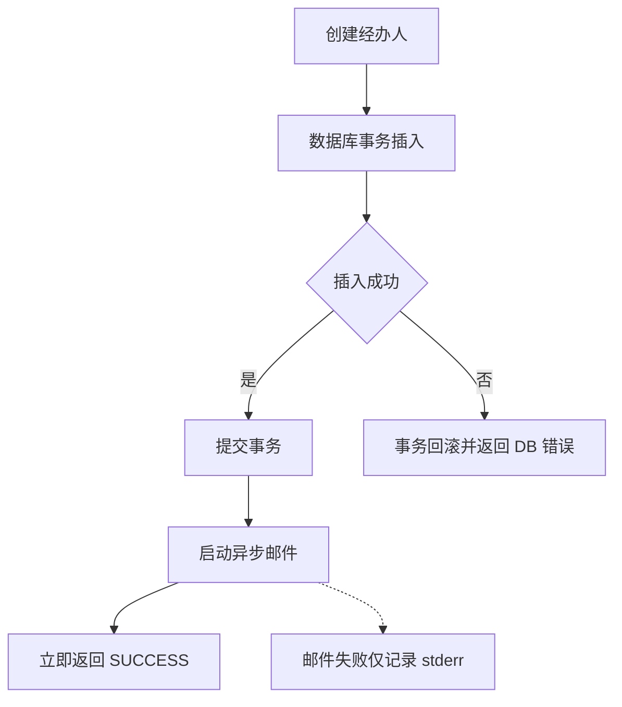

`BID_HANDLER.PERSISTENCE_FAILED` 已在错误码枚举中定义，但基础 CRUD 当前没有主动包装 DAO 异常，因此实际通常返回 `DATABASE.*`。

## 6. 招标公告

### 6.1 端点逐项步骤

| 端点 | 使用流程 | 具体业务步骤 | 成功数据 | 业务异常 |
|---|---|---|---|---|
| `POST /invitation-for-bid/add` | F-CREATE | 校验请求；构造实体；Service 设置 `createdAt=now`、`status=DRAFT`；插入 | `InvitationForBid` | 请求 400；DB 错误 |
| `POST /invitation-for-bid/batch-add` | F-CREATE | 校验 1-100 条；单事务逐条设置 `DRAFT` 并插入 | 实体列表 | 任一失败全部回滚 |
| `GET /invitation-for-bid/{id}` | F-SINGLE | 主键查询 | 实体 | `INVITATION.NOT_FOUND` 404 |
| `PATCH /invitation-for-bid/{id}` | F-SINGLE | 先查；更新非空业务字段；`status` 不在 DTO 中 | `Diff<InvitationForBid>` | `INVITATION.NOT_FOUND` 404 |
| `DELETE /invitation-for-bid/{id}` | F-SINGLE | 物理删除公告 | `null` | `INVITATION.NOT_FOUND` 404 |
| `GET /invitation-for-bid` | F-LIST | 默认 `invitation_id desc` 分页查询 | `PageInfo` | 通用参数/DB 错误 |
| `POST /invitation-for-bid/batch-delete` | F-BATCH-DELETE | 查询实际存在项后物理删除 | 实际删除实体列表 | DB 错误 |
| `POST /invitation-for-bid/status-update` | 专用状态流程 | 查询当前状态；校验状态机；条件更新；插入历史；提交事务 | 更新后的公告 | 不存在 404；非法跳转 400；并发冲突 409 |

数据库没有硬外键，因此新增公告时不会自动验证 `bidHandlerId` 对应的经办人存在；删除经办人也不会自动阻止或级联公告。

### 6.2 状态变更流程

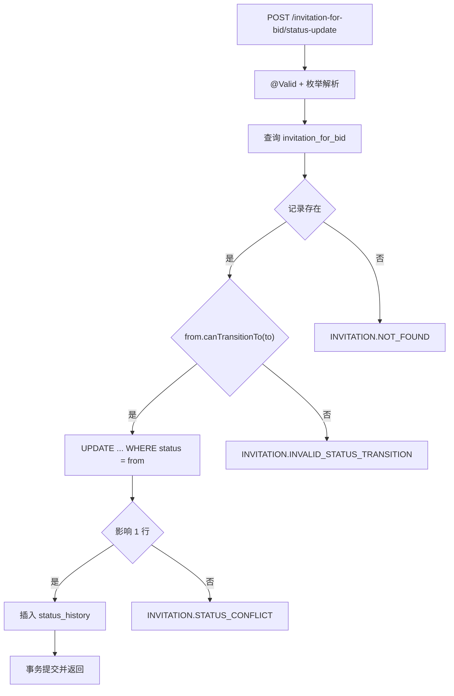

合法状态：

```text
DRAFT → PUBLISHED → CLOSED → AWARDED
  └──────── 任意非 CANCELLED 状态可转 CANCELLED
```

## 7. 投标记录

### 7.1 端点逐项步骤

| 端点 | 使用流程 | 具体业务步骤 | 成功数据 | 业务异常 |
|---|---|---|---|---|
| `POST /bid-record/add` | 专用新增 | 校验基础信息；查询同公告同投标人的最大 `bid_no`；设置下一序号和当前时间；插入；唯一键冲突最多重试 3 次 | `BidRecord` | `BID_RECORD.BID_NO_CONFLICT` 409；其他 DB 错误 |
| `GET /bid-record/{id}` | F-SINGLE | 主键查询，JSON `credentials` 经 TypeHandler 还原为列表 | 实体 | `BID_RECORD.NOT_FOUND` 404 |
| `PATCH /bid-record/{id}` | F-SINGLE | 先查；仅允许更新投标人、报价、联系方式、credentials；更新非空字段 | `Diff<BidRecord>` | `BID_RECORD.NOT_FOUND` 404 |
| `DELETE /bid-record/{id}` | F-SINGLE | 物理删除投标记录 | `null` | `BID_RECORD.NOT_FOUND` 404 |
| `GET /bid-record` | F-LIST | 默认 `bid_record_id desc` 分页 | `PageInfo` | 通用参数/DB 错误 |
| `POST /bid-record/batch-delete` | F-BATCH-DELETE | 查询存在项并物理删除 | 实际删除实体列表 | DB 错误 |
| `GET /bid-record/by-invitation/{invitationId}` | 专用查询 | 按 `invitation_id` 查询；SQL 按 `bid_at ASC` 排序 | `List<BidRecord>` | DB 错误；无记录返回空列表 |

### 7.2 投标序号生成

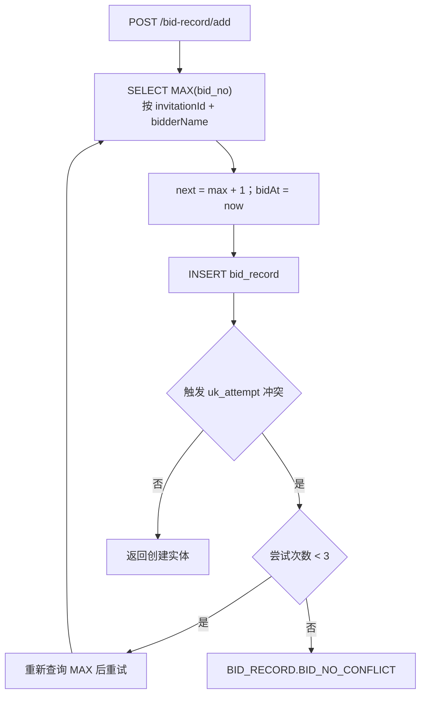

当前不会校验 `invitationId` 对应公告是否存在，因为项目没有数据库硬外键，Service 也没有父记录查询。

## 8. 资信文件上传

### 8.1 `POST /credential-files/upload`

请求为 `multipart/form-data`：

- `bidRecordId`：正整数。
- `files`：重复字段，一次请求提交一个批次的全部文件。
- 后端生成 `uploadBatchId`，前端不传批次号。

具体步骤：

1. Spring 把 multipart 分片包装为 `MultipartFile`。
2. Controller 将每个 `MultipartFile` 适配为 `UploadItem`；`file::getInputStream` 允许按需重新打开流。
3. Controller 创建不可变 `UploadBatch`，交给上传 Service。
4. Service 查询当前 `bidRecordId` 的最大批次号，生成 `batchNo+1` 和 UUID，插入 `credential_file_batch(UPLOADING)`；唯一键冲突最多重试 3 次。
5. 对每个文件按请求顺序处理：
   1. 从请求流计算第一次 SHA-256。
   2. 生成安全 original 路径。
   3. 通过 `FileStorage.store` 写 Local 或 MinIO。
   4. 从存储空间重新读取同一文件；MinIO 场景附带 ETag 条件。
   5. 计算第二次 SHA-256 并比对。
   6. 校验通过后插入 `credential_file(UPLOADED)`。
6. 全部文件成功后，把批次由 `UPLOADING` 条件更新为 `UPLOADED`。
7. 事务提交，返回批次 UUID 与各文件路径、大小和校验和。

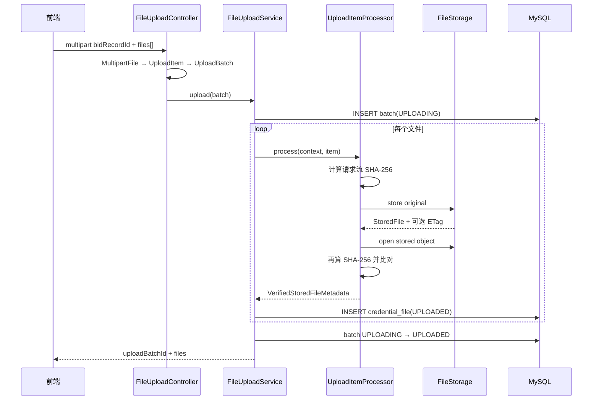

### 8.2 上传异常与补偿

| 失败阶段 | 错误码 | 处理 |
|---|---|---|
| 请求/批次为空、ID 不合法 | `CREDENTIAL_FILE.INVALID_UPLOAD_REQUEST` | 数据库事务回滚 |
| 文件名、大小、流不合法 | `CREDENTIAL_FILE.INVALID_FILE` | 回滚并删除本请求已保存对象 |
| 路径生成不合法 | `CREDENTIAL_FILE.INVALID_PATH` | 回滚；当前文件未写或被删除 |
| Local/MinIO 写入或回读失败 | `CREDENTIAL_FILE.STORAGE_FAILED` | 回滚；处理器删除当前对象，Service 删除此前对象 |
| 两次 SHA-256 不一致 | `CREDENTIAL_FILE.INTEGRITY_CHECK_FAILED` | 删除当前对象，回滚元数据 |
| 批次/文件元数据写入失败 | `CREDENTIAL_FILE.PERSISTENCE_FAILED` | DB 回滚，尽力删除对象 |
| multipart 过大 | `COMMON.FILE_TOO_LARGE` | 在 Controller 前拒绝 |

对象删除是尽力补偿；删除失败会挂在原异常的 suppressed exceptions 中，但不会替换原始错误。

当前上传流程没有校验 `bid_record` 是否真实存在。由于 `bid_record_id` 是逻辑外键，错误 ID 仍可能生成批次行、文件行和对象路径。

### 8.3 `DELETE /credential-files/{uploadBatchId}/files/{fileId}`

当前实现是占位端点：

1. 解析路径参数。
2. 在标准输出打印批次号和文件 ID。
3. 直接返回 `SUCCESS`。

它目前不会：

- 查询文件归属；
- 删除 original；
- 删除 converted Markdown；
- 删除或标记 `credential_file`；
- 更新批次计数或状态。

路径参数类型错误会得到 `COMMON.INVALID_ARGUMENT`；除此之外，即使文件不存在也返回成功。

## 9. 资信文件转换

### 9.1 `POST /credential-files/bid-records/{bidRecordId}/convert`

该接口是“无差别重新转换”入口：

- `UPLOADED`、`FAILED`、`CONVERTED` 批次都允许再次抢占转换。
- `UPLOADING` 或已经由其他请求占有的 `CONVERTING` 批次会被跳过。
- 文件层采用同样的条件抢占。
- Python 只转换单个对象；循环、数据库状态和批次收敛全部由 Java 负责。

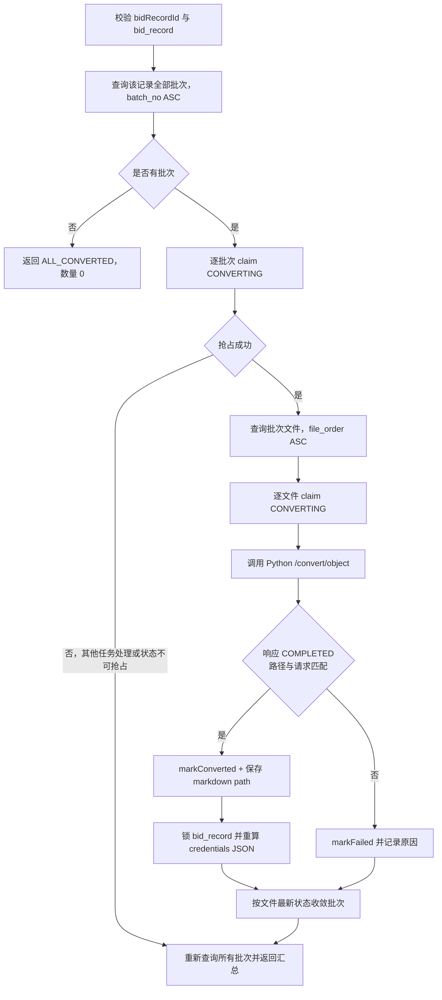

### 9.2 Python 协议

Java 请求：

```json
{
  "originalObjectKey": "bid-records/9/batches/{uuid}/original/{uuid}_file.pdf"
}
```

Java要求响应至少满足：

```json
{
  "originalObjectKey": "与请求完全相同",
  "convertedObjectKey": "非空 Markdown object key",
  "status": "COMPLETED"
}
```

Python 生成 converted 路径并写入存储；Java 不接收 Markdown 正文，只保存 `convertedObjectKey`。

### 9.3 转换结果与异常

| 情况 | 对数据库的处理 | 对 HTTP 的处理 |
|---|---|---|
| 单文件成功 | 文件 `CONVERTED`，保存路径和时间；重算 `bid_record.credentials` | 继续处理 |
| Python 调用失败或响应非法 | 文件 `FAILED`，记录错误 | 继续处理同批次其他文件 |
| 批次存在失败文件 | 批次 `FAILED`，保存已完成数和汇总错误 | 最终通常 HTTP 200 + `PARTIAL_FAILED` |
| 全部文件完成 | 批次 `CONVERTED` | 最终可能 `ALL_CONVERTED` |
| 仍有其他任务处理的文件 | 批次保持 `CONVERTING` | 最终 `PROCESSING` |
| 投标记录不存在 | 不开始转换 | `BID_RECORD.NOT_FOUND` 404 |
| 参数不合法 | 不开始转换 | `COMMON.INVALID_ARGUMENT` 400 |
| 文件数与批次声明不一致 | 批次转失败 | 汇总中体现；错误码通常不直接出 HTTP |

转换端点的一个重要语义是：文件级/批次级业务失败会被转换 Service 收敛为状态和响应数据，通常不会抛到 `GlobalExceptionHandler`。调用方必须同时检查 HTTP 与 `data.status`。

### 9.4 `bid_record.credentials` 回写

每个文件成功后：

1. `SELECT bid_record ... FOR UPDATE` 锁定投标记录。
2. 查询该投标记录下所有 `credential_file`。
3. 过滤 `status=CONVERTED` 且 `markdown_file_path` 非空的记录。
4. 去重并构造路径列表。
5. 整体覆盖 `bid_record.credentials` JSON。

它不会把本次路径追加到旧字符串，因此重复转换不会无限重复。当前该查询按 `upload_batch_id` 字符串和 `file_order` 排序；风险分析不依赖这个 JSON 顺序，而是重新按 `batch_no`、`file_order` 查询。

## 10. 风险分析

### 10.1 查询端点

| 端点 | 具体步骤 | 成功数据 | 异常 |
|---|---|---|---|
| `GET /risk-analysis` | PageHelper 默认按 `analysis_id desc` 分页；查询全部历史；finally 清理分页状态 | `PageInfo<RiskAnalysis>` | 通用参数/DB 错误 |
| `GET /risk-analysis/by-bid-record/{id}` | 按 `bid_record_id` 查询；SQL 按 `analyzed_at DESC` | 历史列表 | DB 错误；无记录为空列表 |

### 10.2 `POST /bid-record/analyze-risk/{id}`

前端只调用风险分析入口，不需要先调用转换端点。服务端先检查当前投标记录的批次和文件状态：

1. 如果全部批次和文件已经是 `CONVERTED`，直接进入 Markdown 汇总和大模型分析。
2. 如果存在 `UPLOADED`、`FAILED` 或其他未完成状态，调用 `FileConvertService.convertAllBatches(bidRecordId)` 无差别执行转换。
3. 转换结束后重新查询数据库；只有所有批次和文件最终为 `CONVERTED` 才继续分析。
4. 如果仍未全部完成，返回 `RISK_ANALYSIS.INPUT_NOT_READY`，不调用大模型。

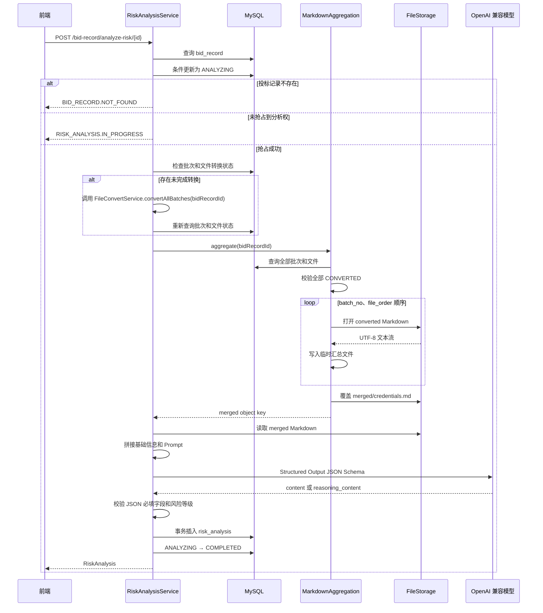

### 10.3 Markdown 汇总格式

固定输出路径：

```text
bid-records/{bidRecordId}/merged/credentials.md
```

正文编排：

```markdown
# 投标记录资信材料汇总

投标记录 ID：9

## 批次 1

### 文件：营业执照.pdf

---

{该文件转换得到的 Markdown}

---
```

- 批次按 `credential_file_batch.batch_no ASC`。
- 文件按 `credential_file.file_order ASC, file_id ASC`。
- 每次分析重新生成临时文件并覆盖固定 merged object，不会把上次汇总再次拼入。
- 默认最多 131072 个 Java 字符，超过后返回 `RISK_ANALYSIS.INPUT_NOT_READY`。
- 临时文件在 `finally` 删除；删除失败不覆盖主异常。

### 10.4 大模型调用与落库

1. `BidRecordLoader` 把投标人名称、报价、联系方式和投标次序转为 Markdown。
2. `PromptFiller` 加载 system/user Prompt 并替换变量。
3. Spring AI 使用 JSON Schema 约束：
   - `riskLevel`：`LOW/MEDIUM/HIGH/CRITICAL`
   - `summary`
   - `suggestions`
4. 优先读取模型 `content`；为空时读取 Spring AI metadata 中的 `reasoningContent`。
5. Fastjson2 解析原始 JSON，并再次校验必填字段和风险等级。
6. 同一事务插入 `risk_analysis` 并把投标记录状态改为 `COMPLETED`。
7. `raw_response` 原样存入 MySQL JSON 列，其他三个字段存解析后的普通列。

### 10.5 风险分析异常

| 阶段 | 错误码 | 状态处理 |
|---|---|---|
| 投标记录不存在 | `BID_RECORD.NOT_FOUND` 404 | 未抢占 |
| 另一个请求已在分析 | `RISK_ANALYSIS.IN_PROGRESS` 409 | 保持对方的 `ANALYZING` |
| 无批次、批次/文件未全部完成、归属或数量不一致、超过长度 | `RISK_ANALYSIS.INPUT_NOT_READY` 400 | 本次已抢占后会标记 `FAILED` |
| 临时文件、converted 或 merged 读写失败 | `RISK_ANALYSIS.MARKDOWN_AGGREGATION_FAILED` 500 | 标记 `FAILED` |
| 模型 API 调用失败 | `RISK_ANALYSIS.LLM_CALL_FAILED` 502 | 标记 `FAILED` |
| 模型返回空、非法 JSON、缺字段、风险等级非法 | `RISK_ANALYSIS.INVALID_LLM_RESPONSE` 502 | 标记 `FAILED` |
| 结果插入或完成状态更新失败 | `RISK_ANALYSIS.PERSISTENCE_FAILED` 500 | 结果事务回滚；随后尽力标记 `FAILED` |

如果 Java 进程在设置 `ANALYZING` 后直接退出，异常补偿没有机会执行，当前没有超时恢复机制。

## 11. 数据库与外部资源的一致性边界

| 操作 | 数据库事务 | 外部副作用 | 失败策略 |
|---|---|---|---|
| 基础 CRUD | 有 | 无或事务后异步邮件 | DB 回滚；邮件不回滚 |
| 文件上传 | 有 | Local/MinIO 写入 | DB 回滚 + 尽力删除对象 |
| 文件转换 | 状态更新为多个短事务/单 SQL | Python 和对象存储 | 文件/批次置 `FAILED`，允许手动重试 |
| Markdown 汇总 | 无跨资源事务 | 临时文件 + 覆盖对象 | 临时文件清理；返回汇总错误 |
| 风险分析 | 抢占与模型调用分离；结果写入有事务 | LLM 调用 | 失败后尽力把投标记录置 `FAILED` |
| 异步邮件 | 不属于业务事务 | SMTP | 只打印失败，不反馈原请求 |

## 12. 按功能分层的异常清单

### 12.1 基础 CRUD 层

| 功能模块 | 已知异常 | 最终出口 |
|---|---|---|
| 经办人读取/更新/删除 | 记录不存在 | `BID_HANDLER.NOT_FOUND` → 全局处理器 |
| 公告读取/更新/删除 | 记录不存在 | `INVITATION.NOT_FOUND` → 全局处理器 |
| 投标读取/更新/删除 | 记录不存在 | `BID_RECORD.NOT_FOUND` → 全局处理器 |
| 任意 CRUD SQL | 重复键、约束、连接、超时、其他 DAO 错误 | `DATABASE.*` → 全局处理器 |
| DTO 绑定与校验 | 缺字段、长度、类型或枚举错误 | `COMMON.*` → 全局处理器 |

### 12.2 跨业务流程层

| 功能模块 | 已知异常 | 最终出口 |
|---|---|---|
| 公告状态流转 | 非法状态机跳转 | `INVITATION.INVALID_STATUS_TRANSITION` |
| 公告状态流转 | 条件更新失败，说明并发状态变化 | `INVITATION.STATUS_CONFLICT` |
| 投标创建 | `bid_no` 连续 3 次冲突 | `BID_RECORD.BID_NO_CONFLICT` |
| 上传 | 文件、路径、存储、完整性、元数据失败 | `CREDENTIAL_FILE.*` |
| 转换 | 投标记录/参数校验失败 | `BID_RECORD.NOT_FOUND` 或 `COMMON.INVALID_ARGUMENT` |
| 转换 | 单文件 Python/协议/持久化失败 | 多数收敛为 `FAILED`，HTTP 200 汇总返回 |
| 风险分析 | 输入未就绪、并发、汇总、LLM、响应、落库失败 | `RISK_ANALYSIS.*` |

### 12.3 不进入全局处理器的异常

| 场景 | 原因 | 调用方看到的结果 |
|---|---|---|
| 经办人 CRUD 异步通知邮件失败 | HTTP 已返回，异常在线程中捕获 | 业务成功；只有 stderr |
| `/send-notification` 异步 SMTP 失败 | 子线程内部捕获 | 已返回“发送成功” |
| 转换的单文件失败 | Service 捕获并写 `FAILED` | HTTP 200，需检查 `data.status` |
| 清理对象失败 | 作为 suppressed exception 附加 | 原始错误保持不变 |

## 13. 当前业务限制

- 上传、转换、风险分析仍是三个独立入口：上传请求不会自动转换；风险分析入口会在需要时自动调用转换，但转换成功后不会在其他请求中自动分析。
- 风险分析在自动转换并重新查询后，只接受全部批次和文件均为 `CONVERTED` 的投标记录。
- 文件删除端点尚未实现真实删除。
- 所有业务关联是逻辑外键；父记录存在性、级联删除和孤儿清理需由应用层保障，但当前部分入口尚未实现。
- 没有鉴权与租户隔离。
- 风险分析和手动重新转换没有互斥；同一投标记录应避免并行执行二者。
- `PromptFiller` 读取 Prompt 失败时返回空字符串，不会抛结构化异常。
