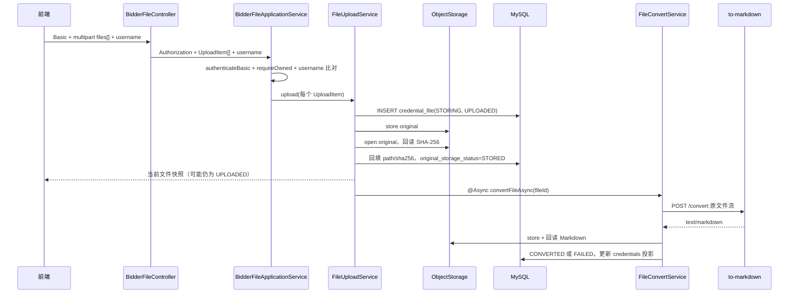

# smart-bid-platform-be 主业务链与失败边界

> 本文描述当前可运行代码的主链。完整 HTTP 字段见 [api.md](api.md)，结构与职责见 [architecture.md](architecture.md)。状态以 MySQL 行为准，SSE 只负责提示前端重新读取。

## 1. 登录与角色边界

招标方和投标方均使用 HTTP Basic。前端只保存并附加凭据，Java 是最终鉴权边界。

| 角色 | 入口 | 鉴权实现 | 资源范围 |
|---|---|---|---|
| 投标方 | `/bidder/**` | 投标记录 CRUD 及 `BidderFileApplicationService` 调用 `BidderAccountService.authenticateBasic` | 只能访问 `bid_record.bidder_account_id` 等于当前账号的投标与资信文件 |
| 招标方 | 管理、知识、风险、下载、chat-agent 路由 | `BidInviterAuthInterceptor` | 当前 demo 中所有已认证招标方共享管理与文件访问范围 |

投标方访问具体投标记录时先加载 `bid_record`：不存在返回 404；存在但 `bidder_account_id` 与当前账号不同返回 403；匹配后才能继续处理。上传、列表、删除、下载和 SSE 订阅都经过这条归属校验。

## 2. 招标公告与投标记录

```text
招标方：公告 / 经办人 / 投标记录管理
  Controller → @Valid → Service → Mapper/XML → MySQL

投标方：创建我的投标
  Basic 鉴权 → 创建 bid_record 并写入 bidder_account_id
  → 后续所有“我的投标”和资信材料操作以该账号归属为边界
```

投标记录序号由 `BidRecordService` 按 `(invitation_id, bidder_name)` 计算，并依靠唯一约束处理并发冲突。数据库关系是逻辑外键，删除父记录不会自动清理文件或风险分析结果。

## 3. 资信材料上传、转换与下载

### 3.1 上传主链

`POST /bidder/bid-records/{bidRecordId}/credential-files` 接收重复 `files` 和当前用户名。一次 HTTP 请求可提交多个文件，但每个文件独立处理、独立返回、独立进入状态机。



上传阶段不维护 `uploadBatchId` 或批次表。原始对象状态与转换状态不能混用：

```text
original_storage_status: STORING → STORED / FAILED
convert_status:          UPLOADED → CONVERTING → CONVERTED / FAILED
```

单文件存储或转换失败会在该行写入 `error_stage`、`error_message` 与失败状态；同一请求中的其他文件继续处理。原始文件已成功写入后，转换失败不会删除它，后续可由招标方转换入口或风险分析的补偿流程重试。

### 3.2 状态更新

Java 会在原始存储、转换成功或失败时发布 `file-status` SSE。前端收到事件后调用列表接口重新读取完整记录；断开、重连或事件丢失时，下一次列表读取仍以数据库状态为准，不需要前端轮询作为主机制。

| 读取目标 | 列表 / 事件 |
|---|---|
| 投标方资信文件 | `GET /bidder/bid-records/{id}/credential-files` / `GET .../events` |
| 招标方资信文件 | 当前后端提供 `/credential-files/{fileId}/download/*` 下载入口；没有与投标方列表等价的招标方文件列表端点 |

### 3.3 下载

下载统一进入 `FileDownloadService`，不会把 object key 作为前端可直接访问的 URL。

- 原文件：要求未删除、`original_file_path` 和 `original_sha256` 均已回填。
- Markdown：额外要求 `convert_status=CONVERTED`、`markdown_file_path` 和 `converted_sha256` 均已回填。
- 投标方下载同时校验文件属于 URL 的 `bidRecordId`；招标方仅做招标方 Basic 鉴权，因此可下载所有符合就绪条件的投标资信材料。
- 响应使用 `Content-Disposition: attachment`；原文件保留安全文件名，Markdown 名称固定为源文件基名加 `.md`。

## 4. 知识文件上传、转换与向量化

`POST /knowledge-files` 由招标方鉴权上下文调用。每个文件生成独立 `documentUuid`，并由后台任务继续处理：

```text
INSERT knowledge_file(STORING, UPLOADED, PENDING)
  → original 存储与回读校验
  → original_storage_status=STORED
  → @Async processStoredFileAsync(documentUuid)
      → to-markdown 转换
      → convert_status=CONVERTED
      → KnowledgeFileVectorStorage 调用 vector-service
      → index_status=VECTORIZED
```

失败按 `UPLOAD`、`CONVERT` 或 `VECTORIZE` 留痕。`POST /knowledge-files/{documentUuid}/retry` 根据当前阶段续跑；删除先抢占 `DELETING`，依次删除向量、original、Markdown，软删数据库行并写历史。知识文件的列表、重试、下载和 SSE 均由文件生命周期表驱动。

## 5. 风险分析

`POST /bid-record/analyze-risk/{id}` 是同步操作：

1. 读取投标记录并条件更新抢占 `ANALYZING`。
2. 查询该记录的全部 `credential_file`。无文件或文件未就绪时，调用 `FileConvertService.convertAll` 重试可抢占文件。
3. 再次查询数据库；只有所有文件为 `CONVERTED` 且 Markdown 路径非空，才汇总 Markdown。
4. 以 `{username}/merged/{bidRecordId}/credentials.md` 覆盖写入汇总对象，调用 OpenAI 兼容模型并解析结构化结果。
5. 成功时事务写 `risk_analysis` 并标记 `COMPLETED`；失败时尽力标记 `FAILED`。

模型调用、Python 调用和对象存储都不是 MySQL 事务的一部分。当前没有风险分析超时恢复，也没有它与手动转换之间的记录级互斥锁。

## 6. chat-agent 会话、检索与持久化

Java 提供会话创建、列表、历史消息、改名、软删除和同步问答接口。问答主链如下：

```text
POST /chat-agent/chat
  → 校验 conversationId + clientMessageId + question
  → 按 conversationId 获取 JVM 锁
  → 短事务：校验归属、处理幂等键、保存 USER 消息与序号
  → 以 conversationId 调用 Python chat-agent（thread_id）
  → 短事务：保存 ASSISTANT 消息、自动标题、完成状态
```

Python 调用失败或返回空回答时，Java 把本次消息标记为失败并返回 `CHAT_AGENT.PYTHON_CALL_FAILED`。单实例 demo 使用 JVM 锁；多实例环境需要额外的分布式并发协调。

chat-agent 的检索工具通过 HTTP 调用 vector-service；vector-service 统一执行查询 Embedding 与 ChromaDB 检索。文件写入、状态查询和删除则由 Java 的 `storage.vector` 适配器直接调用同一个 vector-service，不经过 chat-agent。

## 7. 错误与一致性边界

未被业务服务收敛的异常由 `GlobalExceptionHandler` 转为统一 `Result` 失败体。文件链路的阶段性失败通常不是整体 HTTP 500：它们会写入文件行，前端需要同时观察上传响应、列表状态和 SSE 后的重新读取。

| 边界 | 当前保证 | 不保证 |
|---|---|---|
| MySQL | 状态更新、历史写入和短事务内的 CAS/行锁 | MySQL 与对象存储/Python 的全局原子事务 |
| ObjectStorage | 路径校验、存储后回读校验、删除尽力补偿 | 对象删除一定成功 |
| SSE | 实时提示，带心跳 | 事件可靠投递或离线补偿 |
| 鉴权 | Basic 身份与投标记录归属校验 | 租户隔离、RBAC、细粒度招标方数据范围 |

## 8. 迁移与排错

DDL 目录当前到 V54，且不会被应用自动执行。若 Mapper/实体新增列而开发库未执行相应脚本，列表查询会先在 MyBatis 执行阶段失败并被归类为 `DATABASE.OPERATION_FAILED`。数据库迁移必须按目标库实际执行历史依次补齐并回读结构。
