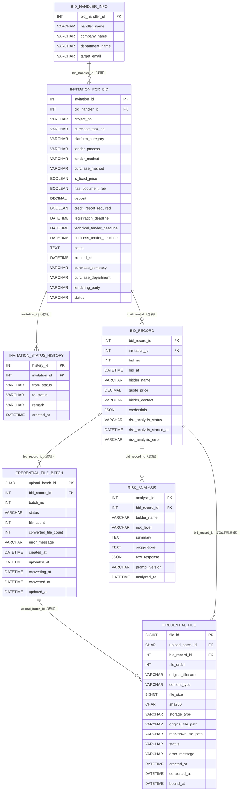
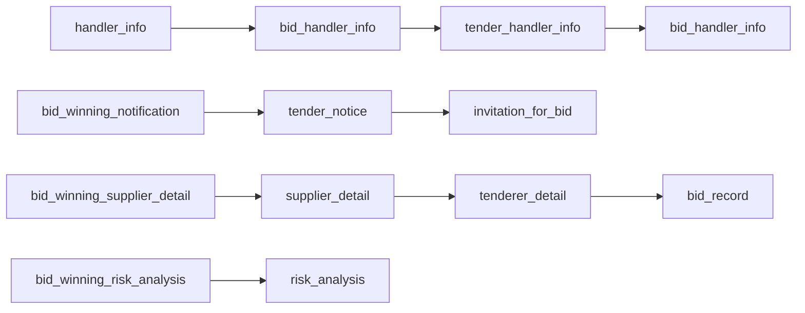
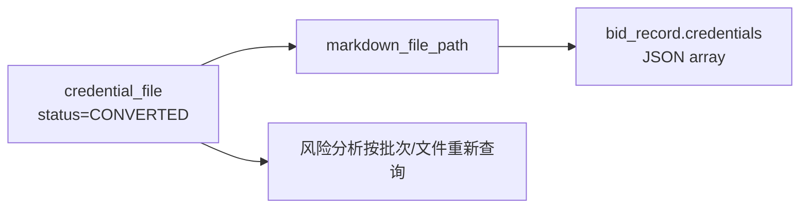
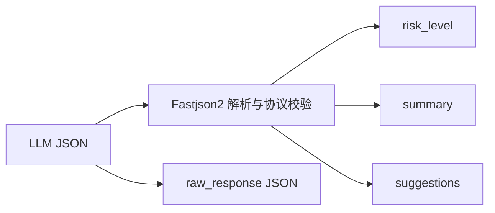

# smart-bid-platform-be 数据库关系与字段文档

> 本文档以 `src/main/resources/sql/ddl/V1-V24` 的最终目标结构、当前实体和 MyBatis XML 为准。
>
> 当前业务层级见 [architecture.md](architecture.md)，端点的数据流见 [business-process.md](business-process.md)。

## 1. 结论与约束

当前最终结构包含 7 张业务表：

1. `bid_handler_info`
2. `invitation_for_bid`
3. `invitation_for_bid_status_history`
4. `bid_record`
5. `credential_file_batch`
6. `credential_file`
7. `risk_analysis`

数据库设计有三个必须先明确的事实：

- 所有关联字段都是逻辑外键，DDL 没有创建任何 `FOREIGN KEY`。
- 表之间没有 SQL 继承关系；“上下关系”是业务父子关系和历史迁移继承关系。
- 文件正文不在数据库中。数据库只保存对象路径、状态、校验和和业务元数据。

## 2. 业务 ER 图



图中的 `FK` 表示业务逻辑外键，不表示数据库实际存在外键约束。

## 3. 上下级与继承关系

### 3.1 业务父子层级

```text
bid_handler_info
└── invitation_for_bid
    ├── invitation_for_bid_status_history
    └── bid_record
        ├── credential_file_batch
        │   └── credential_file
        ├── credential_file（冗余保存 bid_record_id，便于直接查询）
        └── risk_analysis
```

含义：

- 一个经办人可以负责多个招标公告。
- 一个公告可以产生多个状态历史和多个投标记录。
- 一个投标记录可以上传多个资信批次。
- 一个批次包含多个文件。
- 一个投标记录可以产生多次风险分析结果。

### 3.2 不存在的继承

- 7 张表没有“父表字段自动继承到子表”的数据库机制。
- Java 实体也没有共同实体基类。
- `risk_analysis.bidder_name` 是分析时复制的冗余快照，不是从 `bid_record` 动态继承。
- `credential_file.bid_record_id` 与批次表中的 `bid_record_id` 是重复关系字段，数据库不会自动保证两者一致。

### 3.3 历史表名迁移继承



这是迁移历史，不表示运行时同时存在这些旧表。

## 4. 关系字段总表

| 子表字段 | 目标字段 | 基数 | 可空 | 数据库强制 | 应用层使用 |
|---|---|---|---:|---:|---|
| `invitation_for_bid.bid_handler_id` | `bid_handler_info.bid_handler_id` | 多对一 | 否 | 否 | 公告归属经办人 |
| `invitation_for_bid_status_history.invitation_id` | `invitation_for_bid.invitation_id` | 多对一 | 否 | 否 | 公告状态审计 |
| `bid_record.invitation_id` | `invitation_for_bid.invitation_id` | 多对一 | 否 | 否 | 公告下的投标记录 |
| `credential_file_batch.bid_record_id` | `bid_record.bid_record_id` | 多对一 | 否 | 否 | 投标记录的上传批次 |
| `credential_file.upload_batch_id` | `credential_file_batch.upload_batch_id` | 多对一 | 否 | 否 | 批次内文件 |
| `credential_file.bid_record_id` | `bid_record.bid_record_id` | 多对一 | 是 | 否 | 绕过批次直接查全部文件 |
| `risk_analysis.bid_record_id` | `bid_record.bid_record_id` | 多对一 | 否 | 否 | 历史风险分析 |

删除父记录时数据库不会自动：

- 拒绝删除；
- 删除子记录；
- 把子表关联列置空；
- 删除 MinIO/本地文件。

## 5. `bid_handler_info`

用途：保存招标经办人和通知邮箱。

| 字段 | 类型 | NULL | 默认/生成 | 键/关系 | 说明 |
|---|---|---:|---|---|---|
| `bid_handler_id` | `INT` | 否 | `AUTO_INCREMENT` | PK | 经办人 ID |
| `handler_name` | `VARCHAR(50)` | 否 | — | — | 经办人姓名 |
| `company_name` | `VARCHAR(100)` | 否 | — | — | 所属采购公司 |
| `department_name` | `VARCHAR(100)` | 否 | — | — | 所属采购部门 |
| `target_email` | `VARCHAR(255)` | 是 | `NULL` | — | CRUD 通知收件人 |

被引用：

- `invitation_for_bid.bid_handler_id`

当前没有数据库索引以外的引用保障；删除经办人不会处理其公告。

## 6. `invitation_for_bid`

用途：招标公告主表。

| 字段 | 类型 | NULL | 默认/生成 | 键/关系 | 说明 |
|---|---|---:|---|---|---|
| `invitation_id` | `INT` | 否 | `AUTO_INCREMENT` | PK | 公告 ID |
| `bid_handler_id` | `INT` | 否 | — | 逻辑 FK → `bid_handler_info` | 经办人 |
| `project_no` | `VARCHAR(50)` | 否 | — | — | 项目编号 |
| `purchase_task_no` | `VARCHAR(50)` | 否 | — | — | 采购任务编号 |
| `platform_category` | `VARCHAR(50)` | 是 | `NULL` | — | 平台采购类别 |
| `tender_process` | `VARCHAR(50)` | 是 | `NULL` | — | 招标流程 |
| `tender_method` | `VARCHAR(50)` | 是 | `NULL` | — | 招标方式 |
| `purchase_method` | `VARCHAR(50)` | 是 | `NULL` | — | 采购方式 |
| `is_fixed_price` | `TINYINT(1)` | 是 | `NULL` | — | 是否固定总价 |
| `has_document_fee` | `TINYINT(1)` | 是 | `NULL` | — | 是否有标书费 |
| `deposit` | `DECIMAL(15,2)` | 是 | `NULL` | — | 保证金 |
| `credit_report_required` | `TINYINT(1)` | 是 | `NULL` | — | 是否要求征信报告 |
| `registration_deadline` | `DATETIME` | 是 | `NULL` | — | 报名截止 |
| `technical_tender_deadline` | `DATETIME` | 是 | `NULL` | — | 技术回标截止 |
| `business_tender_deadline` | `DATETIME` | 是 | `NULL` | — | 商务回标截止 |
| `notes` | `TEXT` | 是 | `NULL` | — | 备注 |
| `created_at` | `DATETIME` | 否 | `CURRENT_TIMESTAMP` | — | 创建时间 |
| `purchase_company` | `VARCHAR(100)` | 是 | `NULL` | — | 采购公司 |
| `purchase_department` | `VARCHAR(100)` | 是 | `NULL` | — | 采购部门 |
| `tendering_party` | `VARCHAR(100)` | 是 | `NULL` | — | 招标主体 |
| `status` | `VARCHAR(20)` | 否 | `DRAFT` | 状态字段 | `DRAFT/PUBLISHED/CLOSED/AWARDED/CANCELLED` |

索引：

- PK：`invitation_id`
- 由历史迁移保留下来的普通索引 `idx_staff_id(bid_handler_id)`；索引名和现字段语义不完全一致。

被引用：

- `invitation_for_bid_status_history.invitation_id`
- `bid_record.invitation_id`

## 7. `invitation_for_bid_status_history`

用途：审计公告状态机变更。

| 字段 | 类型 | NULL | 默认/生成 | 键/关系 | 说明 |
|---|---|---:|---|---|---|
| `history_id` | `INT` | 否 | `AUTO_INCREMENT` | PK | 历史 ID |
| `invitation_id` | `INT` | 否 | — | 逻辑 FK → `invitation_for_bid` | 公告 |
| `from_status` | `VARCHAR(20)` | 是 | `NULL` | — | 变更前状态 |
| `to_status` | `VARCHAR(20)` | 否 | — | — | 变更后状态 |
| `remark` | `VARCHAR(255)` | 是 | `NULL` | — | 备注 |
| `created_at` | `DATETIME` | 否 | `CURRENT_TIMESTAMP` | — | 变更时间 |

索引：

- PK：`history_id`
- 普通索引：历史名称 `idx_notice_id(invitation_id)`

应用层在一个事务中完成“公告条件更新 + 历史插入”；直接修改数据库公告状态不会自动生成历史。

## 8. `bid_record`

用途：保存某个公告下的一次投标。

| 字段 | 类型 | NULL | 默认/生成 | 键/关系 | 说明 |
|---|---|---:|---|---|---|
| `bid_record_id` | `INT` | 否 | `AUTO_INCREMENT` | PK | 投标记录 ID |
| `invitation_id` | `INT` | 否 | — | 逻辑 FK → `invitation_for_bid` | 所属公告 |
| `bid_no` | `INT` | 否 | `1` | 参与唯一键 | 同公告同投标人的投标次序 |
| `bid_at` | `DATETIME` | 否 | `CURRENT_TIMESTAMP` | — | 投标时间 |
| `bidder_name` | `VARCHAR(100)` | 否 | — | 参与唯一键 | 投标人名称 |
| `quote_price` | `DECIMAL(15,2)` | 否 | — | — | 报价 |
| `bidder_contact` | `VARCHAR(255)` | 是 | `NULL` | — | 联系方式 |
| `credentials` | `JSON` | 是 | `NULL` | 派生字段 | 已转换 Markdown object key 数组 |
| `risk_analysis_status` | `VARCHAR(20)` | 否 | `IDLE` | 状态字段 | `IDLE/ANALYZING/COMPLETED/FAILED` |
| `risk_analysis_started_at` | `DATETIME` | 是 | `NULL` | — | 最近一次抢占分析时间 |
| `risk_analysis_error` | `VARCHAR(1000)` | 是 | `NULL` | — | 最近一次分析错误 |

索引与约束：

- PK：`bid_record_id`
- 唯一键：`uk_attempt(invitation_id, bidder_name, bid_no)`
- 普通索引：`idx_invitation(invitation_id)`

### 8.1 `credentials` 的真实语义



- 它是转换后路径的冗余投影，不是原始文件，也不是 Markdown 正文。
- Java 通过 `Fastjson2TypeHandler` 在 `List<String>` 与 MySQL JSON 之间转换。
- 每个文件转换成功后，Service 会重新查询所有已完成文件并整体覆盖该 JSON。
- 当前 `selectByBidRecordId` 的排序是 `upload_batch_id ASC, file_order ASC, file_id ASC`，不等同于业务 `batch_no` 顺序。
- 风险分析不依赖 `credentials`，而是按 `batch_no` 和 `file_order` 从批次/文件表重新组织，避免 JSON 投影过期或排序偏差。

### 8.2 风险分析状态

```text
IDLE ─┐
      ├→ ANALYZING → COMPLETED
FAILED┤          └→ FAILED
COMPLETED ┘
```

数据库条件更新负责抢占，但没有超时字段索引或自动恢复任务。

## 9. `credential_file_batch`

用途：一次 multipart 上传形成一个不可追加的业务批次。

| 字段 | 类型 | NULL | 默认/生成 | 键/关系 | 说明 |
|---|---|---:|---|---|---|
| `upload_batch_id` | `CHAR(36)` | 否 | Java UUID | PK | 上传批次 ID |
| `bid_record_id` | `INT` | 否 | — | 逻辑 FK → `bid_record` | 所属投标记录 |
| `batch_no` | `INT` | 否 | — | 参与唯一键 | 投标记录内从 1 递增 |
| `status` | `VARCHAR(20)` | 否 | `UPLOADING` | 状态字段 | 上传/转换状态 |
| `file_count` | `INT` | 否 | `0` | — | 声明的文件总数 |
| `converted_file_count` | `INT` | 否 | `0` | — | 已完成文件数 |
| `error_message` | `VARCHAR(1000)` | 是 | `NULL` | — | 批次失败摘要 |
| `created_at` | `DATETIME` | 否 | `CURRENT_TIMESTAMP` | — | 批次创建 |
| `uploaded_at` | `DATETIME` | 是 | `NULL` | — | original 全部完成 |
| `converting_at` | `DATETIME` | 是 | `NULL` | — | 最近开始转换 |
| `converted_at` | `DATETIME` | 是 | `NULL` | — | 全部转换完成 |
| `updated_at` | `DATETIME` | 否 | 自动更新 | — | 最后更新时间 |

索引与约束：

- PK：`upload_batch_id`
- 唯一键：`uk_bid_record_batch_no(bid_record_id, batch_no)`
- 普通索引：`idx_bid_record_id(bid_record_id)`
- 普通索引：`idx_status(status)`

状态：

```text
UPLOADING → UPLOADED → CONVERTING → CONVERTED
                              └──→ FAILED → CONVERTING
CONVERTED 也允许再次进入 CONVERTING
```

## 10. `credential_file`

用途：每个原始上传文件一行，追踪原始对象、转换对象、校验和和状态。

| 字段 | 类型 | NULL | 默认/生成 | 键/关系 | 说明 |
|---|---|---:|---|---|---|
| `file_id` | `BIGINT` | 否 | `AUTO_INCREMENT` | PK | 文件 ID |
| `upload_batch_id` | `CHAR(36)` | 否 | — | 逻辑 FK → `credential_file_batch` | 所属批次 |
| `bid_record_id` | `INT` | 是 | `NULL` | 逻辑 FK → `bid_record` | 直接归属字段 |
| `file_order` | `INT` | 否 | `0` | 排序字段 | 请求内从 0 开始 |
| `original_filename` | `VARCHAR(255)` | 否 | — | — | 清理后的原始文件名 |
| `content_type` | `VARCHAR(100)` | 是 | `NULL` | — | MIME |
| `file_size` | `BIGINT` | 否 | — | — | 字节数 |
| `sha256` | `CHAR(64)` | 否 | — | — | 上传前与存储后回读一致的 SHA-256 |
| `storage_type` | `VARCHAR(20)` | 否 | `LOCAL` | — | `LOCAL/MINIO` |
| `original_file_path` | `VARCHAR(500)` | 否 | — | 对象引用 | original 相对路径/object key |
| `markdown_file_path` | `VARCHAR(500)` | 是 | `NULL` | 对象引用 | converted Markdown object key |
| `status` | `VARCHAR(20)` | 否 | `UPLOADED` | 状态字段 | 文件转换状态 |
| `error_message` | `VARCHAR(1000)` | 是 | `NULL` | — | 最近失败原因 |
| `created_at` | `DATETIME` | 否 | `CURRENT_TIMESTAMP` | — | 元数据创建时间 |
| `converted_at` | `DATETIME` | 是 | `NULL` | — | 最近转换完成时间 |
| `bound_at` | `DATETIME` | 是 | `NULL` | — | 与投标记录绑定时间 |

索引：

- PK：`file_id`
- `idx_upload_batch_id(upload_batch_id)`
- `idx_bid_record_id(bid_record_id)`
- `idx_status(status)`

当前应用在上传时已经知道 `bidRecordId`，因此会立即填写 `bid_record_id` 和 `bound_at`。DDL 中“后续回填”的注释属于更早的设计，和当前上传实现不完全一致。

当前没有唯一约束 `(upload_batch_id, file_order)`，因此顺序唯一性由 Java 上传循环维护。

## 11. `risk_analysis`

用途：保存每次成功风险分析的历史快照。

| 字段 | 类型 | NULL | 默认/生成 | 键/关系 | 说明 |
|---|---|---:|---|---|---|
| `analysis_id` | `INT` | 否 | `AUTO_INCREMENT` | PK | 分析 ID |
| `bid_record_id` | `INT` | 否 | — | 逻辑 FK → `bid_record` | 投标记录 |
| `bidder_name` | `VARCHAR(255)` | 否 | — | 冗余快照 | 分析时的投标人名称 |
| `risk_level` | `VARCHAR(20)` | 否 | — | — | `LOW/MEDIUM/HIGH/CRITICAL` |
| `summary` | `TEXT` | 否 | — | — | 风险摘要 |
| `suggestions` | `TEXT` | 是 | `NULL` | — | 建议；应用层实际要求非空 |
| `raw_response` | `JSON` | 否 | — | JSON 校验 | 模型原始 JSON |
| `prompt_version` | `VARCHAR(20)` | 是 | `NULL` | — | 当前写入 `v1` |
| `analyzed_at` | `DATETIME` | 否 | `CURRENT_TIMESTAMP` | 排序字段 | 分析时间 |

索引：

- PK：`analysis_id`
- 历史名称 `idx_tenderer(bid_record_id)`；列已改名但索引名未再次同步。
- `idx_analyzed_at(analyzed_at)`

### 11.1 原始响应与解析字段



`raw_response` 是 JSON 列，因此数据库会拒绝非法 JSON。HTTP 响应序列化时它作为 Java `String` 再被 JSON 转义，视觉上会出现引号前的反斜杠；数据库中保存的 JSON 本身不是在每个中文字符前增加反斜杠。

## 12. 文件对象与数据库字段的关系

```text
bid-records/{bidRecordId}/
├── batches/{uploadBatchId}/
│   ├── original/{uuid}_{filename}
│   │   └── credential_file.original_file_path
│   └── converted/{name}.md
│       └── credential_file.markdown_file_path
└── merged/credentials.md
    └── 不对应数据库文件行，每次风险分析时覆盖
```

| 对象信息 | 数据库来源 |
|---|---|
| `{bidRecordId}` | `bid_record.bid_record_id` |
| `{uploadBatchId}` | `credential_file_batch.upload_batch_id` |
| original object key | `credential_file.original_file_path` |
| converted object key | `credential_file.markdown_file_path` |
| converted key 列表投影 | `bid_record.credentials` |
| merged object key | 固定规则计算，不落单独元数据表 |

## 13. MyBatis 映射

| 数据库类型 | Java 类型 | 映射方式 |
|---|---|---|
| `INT/BIGINT` | `Integer/Long` | 标准类型处理 |
| `DECIMAL` | `BigDecimal` | 标准类型处理 |
| `DATETIME` | `LocalDateTime` | 标准类型处理 |
| `TINYINT(1)` | `Boolean` | 标准类型处理 |
| 状态 `VARCHAR` | Java enum | `EnumTypeHandler` 或默认枚举映射 |
| `bid_record.credentials JSON` | `List<String>` | `Fastjson2TypeHandler` |
| `risk_analysis.raw_response JSON` | `String` | JDBC 以字符串读写，MySQL 校验 JSON |

核心实体使用 `@TableName`、`@TableId`，实际 CRUD SQL主要来自 `src/main/resources/mapper/*.xml`。

## 14. 数据完整性规则

### 14.1 数据库已强制

- 所有主键唯一。
- `(invitation_id, bidder_name, bid_no)` 唯一。
- `(bid_record_id, batch_no)` 唯一。
- 非空列约束。
- `JSON` 列必须是合法 JSON。
- 字段长度和数值类型。

### 14.2 仅由应用维护

- 经办人、公告、投标、批次、文件和风险记录之间的父记录存在性。
- 同一文件的 `credential_file.bid_record_id` 与其批次 `bid_record_id` 一致。
- `file_count` 等于批次实际文件行数。
- `converted_file_count` 等于状态为 `CONVERTED` 的文件数。
- `credentials` 与已转换文件路径一致。
- 状态机合法跳转。
- 删除父记录时对子记录和对象存储的处理。

### 14.3 可能产生的不一致

| 操作 | 可能结果 |
|---|---|
| 删除经办人 | 公告仍引用不存在的 `bid_handler_id` |
| 删除公告 | 投标和状态历史成为孤儿 |
| 删除投标记录 | 批次、文件、风险记录和对象仍保留 |
| 用不存在的 `bidRecordId` 上传 | 可产生孤儿批次、文件和对象路径 |
| 直接更新文件状态 | 批次计数和 `credentials` 不会自动同步 |
| 直接修改公告状态 | 不会自动写历史 |

## 15. DDL 使用注意事项

`sql/ddl` 采用 Flyway 风格命名，但 `pom.xml` 当前没有 Flyway 依赖，应用启动不会自动迁移。

而且历史脚本不适合作为“从空库无条件顺序执行”的生产迁移集：

- V6 历史脚本引用了后续才出现的 `supplier_detail` 名称。
- V18 会 `TRUNCATE risk_analysis` 和 `TRUNCATE tenderer_detail`。
- V20 会再次 `TRUNCATE risk_analysis` 和 `TRUNCATE bid_record`。
- 多个旧索引名在字段重命名后被保留。

因此：

1. 当前开发库应以 V24 后的最终表结构为准。
2. 上生产前应生成一份经过验证的基线 DDL，而不是直接把 V1-V24 作为无损生产迁移执行。
3. 迁移前必须先制定历史数据保留、旧表映射和对象存储迁移方案。
4. 若后续启用 Flyway，需要先修正历史脚本可重复执行性和基线版本策略。
